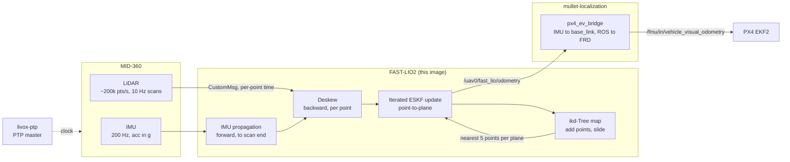

# How FAST-LIO2 works, and how we use it

This page is for whoever tunes or debugs FAST-LIO2 next. It covers what the estimator does, how it
starts, what it publishes, which settings we changed, and the failures to expect.

The values a drone flies with are in
[mullet-localization](https://github.com/skymule-ai/mullet-localization) (`config/fast-lio/`).
This repository's `config/fast-lio/` is an example: upstream's MID-360 file with the changes marked
`mullet`.

## The big picture

The IMU carries the state through a scan. The scan corrects it against a map built from earlier
scans. There are no features and no loop closure: every scan point is matched against a local plane
in the map.

## The estimator: an iterated error-state Kalman filter

### State

| Block | Size | What |
| --- | --- | --- |
| `pos`, `rot` | 3 + 3 | IMU pose in the world frame |
| `offset_R_L_I`, `offset_T_L_I` | 3 + 3 | LiDAR in the IMU frame (held fixed: `extrinsic_est_en: false`) |
| `vel` | 3 | IMU velocity, world frame |
| `bg`, `ba` | 3 + 3 | gyro and accelerometer biases |
| `grav` | 2 | gravity direction (on a sphere, fixed magnitude) |

The covariance `P` keeps this order. The odometry patch reads position and rotation from
`P[0:6, 0:6]` and velocity from `P[12:15, 12:15]`.

### One scan

1. **Propagate.** Integrate every IMU sample up to the scan's end time, saving the pose at each sample.
2. **Deskew.** The MID-360 takes 100 ms to draw a scan while the drone moves. Each point's
   `offset_time` (CustomMsg) selects the IMU pose at the moment it was measured, and the point is
   moved into the scan-end frame. This is why the driver must send CustomMsg: FAST-LIO's
   PointCloud2 path for the MID-360 invents the times from the azimuth, which is wrong for a
   non-repetitive pattern.
3. **Downsample** to `filter_size_surf` (0.5 m), after keeping every `point_filter_num`-th point (3)
   and dropping points within `blind` (0.5 m).
4. **Update.** For each point, the 5 nearest map points define a plane, and the residual is the
   point's distance to it. The filter iterates (up to `max_iteration`, 3), re-finding the planes
   each time, until the update converges.
5. **Map.** The scan, in the world frame, is added to the ikd-Tree (downsampled to
   `filter_size_map`). The tree keeps a cube of `cube_side_length` around the drone and drops what
   leaves it.

## Start-up

The first ~20 IMU samples set the gravity direction, the gyro bias and the accelerometer scale. The
MID-360 IMU reports in g; FAST-LIO rescales by the mean norm. **Keep the drone still at start.**

The world frame `camera_init` is **gravity-aligned** (`patches/gravity-align.patch`): z is up, and
the heading is the IMU's at start-up. Upstream used the IMU frame at start-up as the world, so a
tilted mount or a sloped take-off spot tilted the world's z axis, and horizontal flight leaked into
height. In the synthetic check with a 20° mount, that was 1.9 m over 5.7 m. px4_ev_bridge assumes z-up.
mullet1's MID-360 sits about 1.6° from level (measured 2026-10-19).

## What it publishes

| Topic | Frame | Notes |
| --- | --- | --- |
| `/uav0/fast_lio/odometry` | `camera_init` → `body` (MID-360 IMU) | one per scan (10 Hz), stamped at the scan end |
| `/uav0/fast_lio/path` | `camera_init` | every 10th pose |
| `/uav0/fast_lio/cloud_registered_body` | `body` | deskewed scan: the cloud to view or map from |
| `/uav0/fast_lio/cloud_registered` | `camera_init` | the same, in the world |
| TF `camera_init` → `body` | | upstream frame names, kept |

The odometry is standard after the patch: pose covariance in ROS order (x, y, z, rot x, rot y,
rot z), linear twist in `body` (`Rᵀ·v`), angular twist the last gyro sample minus the bias. Upstream
published the previous scan's covariance with position and rotation swapped, and a zero twist.

## Settings we changed

| Setting | Upstream | Ours | Why |
| --- | --- | --- | --- |
| `extrinsic_est_en` | `true` | `false` | the LiDAR-IMU extrinsic is a factory value; estimating it adds drift when the motion is poor |
| `map_en` | `true` | `false` | publishes the whole map every scan: unbounded bandwidth on the Orin |
| `pcd_save_en` | `true` | `false` | keeps every scan in RAM until shutdown |
| CMake standard | C++14 | C++17 | Jazzy's rclcpp |
| initial attitude | identity (world = IMU at start) | from gravity (`gravity-align.patch`) | world z up for the bridge, whatever the mount |
| IMU queue | 10 samples (50 ms) | 2000 (10 s) (`imu-gaps.patch`) | a slow scan dropped IMU samples |
| scan with no IMU sample | processed with the previous scan's points | skipped, with a warning (`imu-gaps.patch`) | stale points; with the odometry patch, a segfault |

On aarch64, upstream builds without its OpenMP nearest-neighbour search (`MP_PROC_NUM=1`). Enable it
only if `docker stats` shows FAST-LIO falling behind the 10 Hz scans.

## Failure modes to expect

- **Geometric degeneracy.** Long corridors, tunnels, open fields with only the ground, a wall of
  foliage seen from far: the planes don't constrain one direction, and the estimate slides along
  it. Indoors this shows up as drift along a corridor; outdoors over grass, as drift in x/y.
- **Too close.** Points inside `blind` are dropped. In tight spaces too few points remain. Lower
  `blind` only if the frame and props are out of the field of view.
- **"No IMU sample in this scan, skip it".** The scan's time window holds no IMU sample: IMU dropped
  or late. A few at start-up are harmless. Steady warnings mean FAST-LIO is falling behind (check
  `docker stats`) or the IMU stream has gaps.
- **Moving at start.** Gravity and the biases are wrong, and the estimate diverges in seconds.
  Restart the container with the drone still.
- **Unsynced time.** Without PTP, the driver stamps every LiDAR and IMU packet with the Orin's
  clock on arrival: ROS time, but a few ms late and jittered, LiDAR and IMU independently. The
  deskew and the IMU-to-scan alignment absorb that jitter, and the odometry stamps run late by the
  link latency (EKF2_EV_DELAY must absorb it). Run `livox-ptp`.
- **Props in the cloud.** The MID-360's field of view reaches down to −7°. If propeller or frame
  points appear in `cloud_registered_body`, they move with the drone, and the map is corrupted.
  Raise `blind`, or mount the LiDAR higher.
